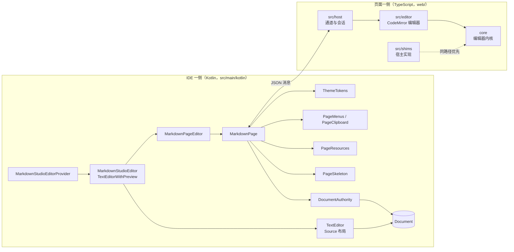

# Markdown Studio 架构设计

Markdown Studio 让 JetBrains IDE 里的 Markdown 文件可以在渲染后的文档中直接编辑，同时保留 IDE 的撤销、本地历史、版本控制、键位和主题。这篇文档写给要修改插件的开发者：读完应该知道插件由哪几块组成，一次输入怎样从页面走到 IDE 的 Document，以及某类改动该去哪个目录。

插件分成两半。IDE 一侧是 Kotlin 代码，负责编辑器注册、文档、按键、菜单和设置。页面一侧是运行在 IDE 内置浏览器（JCEF）里的 TypeScript 应用，负责渲染和编辑交互。两半之间只有一条 JSON 消息通道。

## 目标与边界

Markdown Studio 要做到三件事：

- 在渲染后的文档里编辑（Live Preview），只有光标所在处显示 Markdown 源码。
- 每次修改都是文件 Document 上的一条 IDE 命令，撤销、本地历史和版本控制照常工作。
- 外观和操作跟随 IDE：配色方案、字体、缩放、键位、界面语言。

几条边界决定了很多实现细节：

- Source 布局使用 IDE 自带的文本编辑器，插件只负责页面一侧的编辑。
- 文本只存在于 IDE 的 Document 中，页面持有的是副本。页面不直接读写磁盘，本地图片也由 IDE 读出后交给页面。
- IDE 运行时不支持 JCEF 时，插件不接管 Markdown 文件，交回 IDE 自带编辑器打开。

## 整体结构

各目录的职责：

| 位置 | 内容 |
| --- | --- |
| `src/main/kotlin/.../editor` | 编辑器提供者，四种布局，Source 与页面之间的光标交接 |
| `src/main/kotlin/.../page` | 浏览器页面、消息协议、文档同步、资源服务、菜单、剪贴板、主题、加载骨架屏 |
| `src/main/kotlin/.../actions` | Markdown 命令和页面内编辑动作对应的 IDE Action，快捷键优先级 |
| `src/main/kotlin/.../settings` | 设置项和三个设置页 |
| `src/main/kotlin/.../welcome` | 欢迎页：标签页文件、编辑器、JCEF 页面、首次安装时的触发 |
| `src/main/resources` | `plugin.xml`、中英文资源包、插件图标，`welcome/` 下是欢迎页和导览文档 |
| `web/core` | 编辑器内核：Markdown 语言、Live Preview、斜杠命令、表格、预览、大纲、文案目录、设计 token、图标 |
| `web/src/shims` | 内核里依赖宿主的模块（IPC、键位、菜单、编辑器注册、打开文件）在 IDE 里的实现 |
| `web/src/host` | 页面一侧的通道与会话：消息收发、主题、语言、偏好、网络图片 |
| `web/src/editor` | 页面的 CodeMirror 编辑器：装配、文档同步、IDE 编辑动作、查找栏 |
| `web/src/app` | 页面外壳和样式 |

## 打开一个 Markdown 文件

1. IDE 询问 `MarkdownStudioEditorProvider`。它在 `plugin.xml` 中以 `order="first"` 注册，策略是 `HIDE_OTHER_EDITORS`。设置里启用了插件、扩展名是 `md`、`markdown`、`mdown`、`mkd`、`mkdn`、`mdwn` 之一，并且 `JBCefApp.isSupported()` 为真时，它接受这个文件。
2. 提供者创建 `MarkdownStudioEditor`。它继承平台的 `TextEditorWithPreview`，一边是 IDE 文本编辑器，一边是 `MarkdownPageEditor`。四种布局映射到平台的三种 Layout：Live Preview 和 Preview 都是 `SHOW_PREVIEW`，区别在页面模式。第一次打开的文件使用设置里的默认布局。
3. `MarkdownPage` 创建 `JBCefBrowser`，同时显示加载骨架屏，然后加载 `https://markdown-studio.localhost/index.html`。这个地址由 `PageResources` 拦截，内容从插件 jar 的 `/web` 目录读取；`index.html` 中的 `<!--studio-host-->` 占位符被替换成一段脚本，定义页面向 IDE 发消息用的 `window.__studioPost`。
4. 页面脚本启动后发出 `ready`，IDE 回复 `init`，内容包括文本、版本号、只读状态、页面模式、语言、主题 token、快捷键、偏好和初始选区。
5. 页面建好编辑器、文档画到屏幕上之后发出 `rendered`，骨架屏在 220 ms 内淡出。

### 加载骨架屏

从创建浏览器到页面画出文档要花一段时间，打开演示用的 README 约 1 秒。这段时间编辑区显示 `PageSkeleton`：一组按文档形状排列的浅色条（标题、段落、代码块、列表和大纲），一道柔和的高光从左向右扫过。颜色取自当前编辑器配色，深浅主题都适用。

骨架屏是盖在浏览器上面的 Swing 组件，由 `PageStack` 叠放。放在 IDE 一侧是因为浏览器进程启动、页面脚本加载期间页面本身还画不出任何东西，只有 Swing 能立刻显示。它按页面的真实尺寸绘制：阅读宽度、正文字号、Live 与预览各自的内边距、大纲栏（开启且页面宽度不小于 900 px 时显示，宽 248 px），所以淡出时文字正好落在骨架条的位置上。页面重新加载时骨架屏会再次出现；页面 10 秒内没有发出 `rendered`，骨架屏自动撤掉，露出页面当时的状态，便于排查。

## 文档同步

IDE 的 Document 是唯一的文本来源，页面里的 CodeMirror 文档是它的副本。两边用 [@codemirror/collab](https://codemirror.net/docs/ref/#collab) 的版本协议对齐，实现在 `DocumentAuthority`（IDE）和 `web/src/editor/documentSync.ts`（页面）：

- Document 每变化一次，版本号加一。来自 IDE 的变化（Source 编辑器、撤销、重新格式化、VCS 回滚）以 `updates` 消息发给页面。
- 页面把本地修改连同它已知的版本号以 `push` 发出，同一时间只有一个 `push` 在途。版本号一致时，IDE 在一条命令里应用这些修改，再把它们作为 `updates` 发回，页面据此确认。版本号落后时，IDE 只回一个空的 `updates`；页面在收到缺失的修改后变基，再重新提交。
- 修改长度与 Document 对不上、文件无法写入，或者应用期间 Document 被别处改动时，IDE 发送 `reset`，页面整体换成 Document 的当前文本。

页面没有自己的撤销历史，撤销和重做都由 IDE 的 `UndoManager` 完成。为了让撤销粒度和 IDE 编辑器一致，`TypingGroups` 把 2 秒内同一处的连续输入或连续删除合并进同一个命令组；粘贴、格式命令、换到别处输入都会开始新的一组。撤销或重做后，IDE 把页面光标移到改动末尾。

平台在撤销时会恢复编辑器状态，而 `TextEditorWithPreview` 的状态里带着布局。`MarkdownStudioEditor` 在 `UNDO` 级别的状态中去掉布局，所以在 Source 布局里撤销一次 Live Preview 中的输入，只会撤回文字，不会切回 Live Preview。

同一个文件可以同时在多个编辑器里打开（分屏、多窗口），它们共享一个 Document，因此始终一致。

## 按键与动作

IDE 先处理按键（`IdeKeyEventDispatcher`），没被 IDE 动作消费的按键才进入浏览器，由页面的 CodeMirror 键位处理。插件注册了两类动作：

- `MarkdownStudio.<Name>`（`MarkdownCommandAction`，共 26 个）：加粗、标题、插入表格等 Markdown 命令。动作 ID 与页面命令一一对应，`MarkdownStudio.InsertTable` 运行页面的 `markdown.insertTable`。它们出现在 Find Action 中，在 Keymap 里按 `plugin.xml` 中的“格式 / 段落 / 插入”分组排列，用户可以给它们改快捷键。
- `MarkdownStudio.Page.<Name>`（`PageEditorAction`，共 17 个）：复制行、删除行、移动行、扩展选区、合并行、查找、替换、全选等 IDE 编辑器动作在页面中的版本。它们用 `use-shortcut-of` 继承对应 IDE 动作的快捷键，用户修改 keymap 后一起生效。`MarkdownStudio.Page.MoveLineUp` 运行页面的 `editor.moveLineUp`。

同一个快捷键常有多个候选动作，比如 ⌘D 在 IDE 里还对应比较文件。Live Preview 编辑时，`MarkdownStudioActionPromoter` 把上面两类动作和 IDE 的撤销、重做排到最前，这条规则在所有平台上都生效。撤销和重做需要单独提升：JCEF 给浏览器组件注册了 ⌘Z、⌘⇧Z、⌘A、⌘X、⌘C、⌘V 等组件级快捷键（在 macOS 上确认过，其他平台未验证），它们排在 keymap 动作之前；不提升的话，⌘Z 会执行浏览器自带的撤销，而页面编辑器没有撤销历史，按下去没有反应。Preview 模式只显示文档，不做这种提升。全选由 `MarkdownStudio.Page.SelectAll` 接管，光标在代码块、front matter 或公式块里时先选中块内容。剪切、复制、粘贴沿用 JCEF 的处理，效果与插件的 CopyProvider 相同，在 Preview 模式下也能使用。

页面新增 Markdown 命令或编辑动作时，要在 `plugin.xml` 注册对应的 IDE 动作，并在两个资源包里补上文案。`web/src/actionParity.test.ts` 会比对页面命令和 `plugin.xml`，漏注册时测试失败。

## 菜单、剪贴板与链接

右键菜单的内容由页面决定，显示交给 IDE。页面把菜单项（文字、图标名、快捷键、勾选状态、子菜单）发给 IDE，`PageMenus` 用 IDE 的 `ActionPopupMenu` 弹出，用户选中后 IDE 回传 `menuInvoke`，页面执行对应操作。编辑器菜单最前面是 IDE 的剪切、复制、粘贴，后面是页面的“格式 / 段落 / 插入”，这三组由 `web/core/features/viewers/markdown/livePreview/actions.ts` 中的 `registerMenuGroup` 定义。菜单项上显示的快捷键取自对应的 `MarkdownStudio.<Name>` 动作，所以用户在 Keymap 中改过的快捷键会出现在菜单上。这样菜单的外观、键盘导航和快捷键显示都与 IDE 原生菜单一致。

页面复制文本时，可以通过 `copyText` 消息直接写入 IDE 剪贴板，使内容出现在 IDE 的剪贴板历史里。

链接分两种处理。指向本地文件的链接由 IDE 用 `OpenFileDescriptor` 在编辑器中打开；`http`、`https`、`mailto` 链接交给 `BrowserUtil`，用系统浏览器打开。浏览器内任何离开页面地址的导航都会被 `PageResources.onBeforeBrowse` 拦下，新窗口请求同样转到系统浏览器。

## 外观、语言与设置

`ThemeTokens` 把 IDE 的外观转换成页面使用的 CSS 变量。页面的明暗由编辑器配色方案决定，因为文档属于编辑区。IDE 界面颜色只在界面与配色的明暗一致时才覆盖页面颜色，这样浅色界面配深色编辑器时不会出现看不清的组合。半透明颜色会先与编辑器背景合成，因为 Mermaid 图表无法处理透明色。字体取编辑器字体和连字设置。IDE 缩放（View | Appearance | Zoom IDE）由 JCEF 自己处理：离屏渲染的设备像素比已经包含 IDE 缩放，所以插件不再设置浏览器缩放，否则页面会被放大两次；插件只用这个比例把页面坐标换算成组件坐标（右键菜单的位置、骨架屏的尺寸）。另外，Chromium 让同一来源的所有页面共享缩放级别，编辑器页面和欢迎页都在 `markdown-studio.localhost` 下，任何一个页面改动缩放都会影响全部页面。

插件文案在 `src/main/resources/messages/MarkdownStudioBundle*.properties`，页面文案在 `web/core/platform/locales`。语言设置为“跟随 IDE”时，IDE 语言是中文就使用简体中文，其他情况使用英文；用户也可以在设置里固定一种。切换后，IDE 侧的动作文字、右键菜单和设置页，以及页面里的斜杠命令、表格操作和提示会同时更新。设置树里的节点名由平台按 IDE 语言显示，不受这个设置影响。

设置保存在 IDE 配置目录的 `options/markdown-studio.xml`。点击 Apply 后，`MarkdownStudioSettings` 在消息总线上发出通知，每个打开的页面据此更新语言、主题、偏好和网络图片开关。`MarkdownPage` 还订阅了界面主题、编辑器配色、界面设置和 keymap 的变化，变化时推送新的 token 或快捷键。

## 页面资源与安全

页面地址固定为 `https://markdown-studio.localhost/`。`.localhost` 只会解析到本机，并且属于浏览器的安全上下文；所有请求都在 `PageResources` 里应答，不会发到网络。请求路径经过校验，含 `..` 的路径直接拒绝，页面只能读到 jar 内 `/web` 下的文件。

`index.html` 的内容安全策略（CSP）只允许本页脚本。图片允许 `data:`、`blob:` 和网络地址，用于 README 中的徽章和截图；是否加载网络图片由设置控制。本地图片通过 `request` 消息（方法 `readImage`）请 IDE 读取，IDE 只接受常见图片扩展名、最大 32 MB 的文件，以 data URL 形式返回。

IDE 默认用离屏渲染（OSR）显示浏览器，帧率上限是 30 fps。`MarkdownPage` 在页面开始加载时把帧率设为 60 fps，打字和滚动因此更跟手。

## 页面工程

`web/` 是一个 Vite、React 和 CodeMirror 6 工程。`./gradlew processResources` 会先构建页面，再把产物复制到插件 jar 的 `/web` 目录，字体只保留 woff2。内核里的 Markdown 图标同时复制到 jar 的 `/icons/markdown`，并生成新 UI 深色主题用的 `_dark` 版本，供 IDE 侧的动作图标使用。

模块解析有一条约定：`@/…` 先在 `web/src/shims` 中查找，找不到再到 `web/core` 中查找。这条规则在 `vite.config.ts` 的 `coreOverlay` 插件里实现，`tsconfig.json` 的 `paths` 和 `rootDirs` 保持同样的顺序。内核中依赖宿主的模块，比如 IPC、键位、菜单、打开文件，在 shims 里放一个同路径的 IDE 版本。修改编辑行为时直接改 `web/core`；只有和宿主有关的差异才放进 shims。

## 欢迎页

插件第一次安装后，IDE 会打开一个“欢迎使用 Markdown Studio”标签页：插件介绍、“打开导览”和“设置”两个按钮、新文件默认布局的选择、功能卡片、常用快捷键，以及自定义快捷键的入口。Help | Markdown Studio Welcome 可以随时再打开它。

标签页背后是一个 `WelcomeFile`（`LightVirtualFile`，文件类型 `WelcomeFileType` 只用来提供标签图标），由 `WelcomeEditorProvider` 打开为 `WelcomeEditor`。页面是 `src/main/resources/welcome/` 下的静态 HTML、CSS 和 JavaScript，由 `PageResources` 以 `welcome` 为根目录提供，和编辑器页面使用同一个地址和安全策略。IDE 在注入的脚本里放入页面数据（文案、主题 token、快捷键、当前默认布局），主题、语言、keymap 或设置变化时调用 `window.__welcomeRender` 更新页面；页面的按钮通过 `window.__studioPost` 把操作发回 IDE。

“只显示一次”由设置里的 `welcomeVersion` 记录，版本号来自构建时写入的 `welcome/build.properties`（平台读取插件描述符的接口在 2026.2 中是内部 API）。插件有两种安装结果：需要重启时，下次打开项目由 `WelcomeStartup`（`postStartupActivity`）显示；不需要重启时，`WelcomeInstallListener` 收到 `DynamicPluginListener.pluginLoaded`，在当前项目里显示。这个监听器用 Java 写在 `src/main/java` 下：Kotlin 实现平台的这个接口时，会为接口的每个默认方法生成覆盖，其中包括已弃用和实验性的方法，Plugin Verifier 会因此报告问题。

欢迎页的“自定义快捷键”打开 Settings | Keymap，并用搜索词 `MarkdownStudio` 过滤（Keymap 搜索也匹配动作 ID，这样能列出插件的全部动作）。过滤要等 Keymap 页面显示之后才能做：页面加载期间搜索会在平台内部抛出异常，而且第一次打开时，页面显示后的初始化还会清空搜索，所以 `Welcome.filterWhenShown` 在页面显示时和半秒后各设置一次。导览是一份 Markdown 草稿文件（按插件语言选 `tour_en.md` 或 `tour_zh.md`），以 Live Preview 打开。

## 关键取舍

**编辑器放在 JCEF 页面里。** Live Preview 需要把表格、公式、Mermaid 图表渲染成可交互的控件，并允许在表格单元格里继续编辑。IDE 编辑器的 inlay 和折叠只能做静态装饰，承载不了这些控件。JCEF 是所有 JetBrains IDE 自带的组件，IDE 自带的 Markdown 预览也用它。代价是多一个浏览器进程，以及按键、焦点和菜单需要额外桥接。

**Document 是唯一的文本来源。** 另一种做法是让页面持有文本并自己保存文件，那样撤销、本地历史和 VCS 都要另做一套，还会和同一文件的其他编辑器冲突。现在的做法需要维护版本协议和 `reset` 兜底，换来的是页面的每次修改都和普通编辑一样进入 IDE。

**菜单用 IDE 原生弹出菜单。** HTML 菜单更容易做，但外观、键盘导航、快捷键显示会和 IDE 不一致，而且菜单无法超出浏览器区域。原生菜单的代价是菜单项需要序列化后传给 IDE。

**骨架屏画在 Swing 一侧。** 理由见“加载骨架屏”一节。代价是骨架屏的几何尺寸要和页面样式手动保持一致，没有测试会发现两边对不齐。阅读宽度和正文字号由插件设置和 `ThemeTokens.textSize()` 计算，两边共用，会自动一致；下面这些是 `PageSkeleton` 里抄自页面的常量，修改页面对应样式时要一起改：

| `PageSkeleton` 常量 | 页面中的来源 |
| --- | --- |
| `LIVE_PAD`（28）、`LIVE_TOP`（4）、`LINE`（1.75） | `web/core/features/viewers/markdown/livePreview/theme.ts` 中的 `--md-pad` 和正文 `lineHeight` |
| `PREVIEW_PAD`（40）、`PREVIEW_TOP`（28） | `web/core/features/viewers/markdown/Markdown.module.css` 中 `.preview` 的 `padding` |
| `OUTLINE_WIDTH`（248）、`OUTLINE_MIN_PAGE`（900）、`OUTLINE_PAD`（14） | `web/core/features/viewers/markdown/DocumentNav.tsx` 的大纲默认宽度和 `MIN_WIDTH_FOR_OUTLINE`，`Markdown.module.css` 中 `.outlineList` 的 `padding` |

**页面使用 `.localhost` 地址。** 与 `file://` 或 `data:` 相比，它是安全上下文，可以使用剪贴板等 Web API，内容安全策略可控，也不会把文件系统暴露给页面。

## 测试与验证

- `./gradlew check`：Kotlin 平台测试（`BasePlatformTestCase`），覆盖 ChangeSet 转换、文档同步、撤销分组、资源路径、消息协议、主题 token、动作注册、设置与资源包；以及页面的类型检查和 Vitest 测试，覆盖编辑命令、文档同步、查找栏、菜单、动作对齐和内核自带的测试。
- `./gradlew verifyPlugin`：用 IntelliJ Plugin Verifier 检查推荐的 IDE 版本。
- `./gradlew runIdeForUiTests`：启动带 robot-server（端口 8082）的沙箱 IDE，用于脚本化检查运行中的插件；页面 DevTools 在 9222 端口。

## 已知限制

- Live Preview 中，Setext 标题的下划线和 HTML 注释以淡色源码显示。
- `
` 的结束标签在 Live Preview 中保留为源码；Preview 中 `
` 的内容没有嵌套在折叠块里。
- 命名脚注在 Live Preview 中显示标签名。
- 跨文件链接中的 `#anchor` 只会打开目标文件，不跳到锚点。
- 2026.3 平台把 `FileEditorProvider.readState` 的旧重载标为弃用。为了兼容 2026.2，插件继续使用它，Plugin Verifier 会报告 1 处弃用 API。
- 用户拖动改变大纲宽度后，骨架屏仍按默认的 248 px 绘制大纲栏。
- 骨架屏在非离屏渲染模式下的表现未验证。
