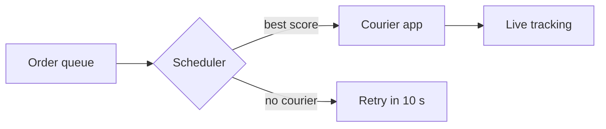

# Delivery Scheduler

The scheduler assigns each order to a courier within **two seconds** and keeps the plan *up to date* as traffic changes. It replaces the nightly batch job described in [the previous design](roadmap.md).

> [!TIP]
> Edit this page right here: the Markdown appears only around the caret.

## Goals

| Goal | Target | Status |
| :--- | :---: | :--- |
| Assignment latency | < 2 s | Shipped |
| Re-plan on traffic change | < 30 s | In progress |
| Couriers per region | 5,000 | Shipped |

- [x] Stream orders from the queue
- [x] Score couriers by distance and load
- [ ] Re-plan when a road closes

## Scoring

Each courier $c$ gets a score from its distance $d_c$ and current load $l_c$:

$$
s_c = \frac{1}{1 + d_c} \cdot e^{-\lambda l_c}
$$

```kotlin
fun score(courier: Courier, order: Order): Double {
    val distance = courier.position.distanceTo(order.pickup)
    return 1.0 / (1.0 + distance) * exp(-LAMBDA * courier.load)
}
```

## Flow



## Open questions

1. Should couriers be able to decline an assignment?
2. How long do we keep tracking data?[^retention]

[^retention]: Legal asks for 90 days; analytics would like a year.
