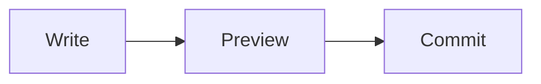

# Markdown Studio Tour

This is a scratch file: change anything, nothing here is precious. You are in **Live Preview** — the document is rendered, and the Markdown shows only around the caret.

## Write in the document

Put the caret inside **bold**, *italic*, ~~strikethrough~~ or `inline code` to see their marks; move away and they render again. Links work too: [CommonMark](https://commonmark.org) opens in your browser.

Select a few words and a formatting toolbar appears above them.

## Insert with /

Start an empty line with `/` and pick a block — a heading, a list, a table, a code block, math, a callout or a diagram. Try it on the line below:


## Tables

| Layout | What you see | Good for |
| :--- | :--- | :--- |
| Live Preview | The rendered document, editable | Writing |
| Source and Preview | The source beside its preview | Reviewing Markdown |
| Preview | The rendered document | Reading |

Click a cell to edit it. Right-click a cell for row and column actions.

## Code, math and diagrams

```kotlin
fun greet(name: String) = "Hello, $name!"
```

Inline math such as $e^{i\pi} + 1 = 0$, or a block:

$$
\sum_{k=1}^{n} k = \frac{n(n+1)}{2}
$$



## Callouts, tasks and footnotes

> [!TIP]
> Right-click anywhere for Format, Paragraph and Insert; every command is also in Find Action.

- [x] Open the tour
- [ ] Type `/` on an empty line
- [ ] Switch layouts from the editor toolbar

Footnotes keep asides out of the way.[^1]

[^1]: Like this one.

## Your IDE, as usual

Undo, local history and version control see every edit. The outline on the right lists the headings; the toolbar above switches between Live Preview, Source, Source and Preview, and Preview.
